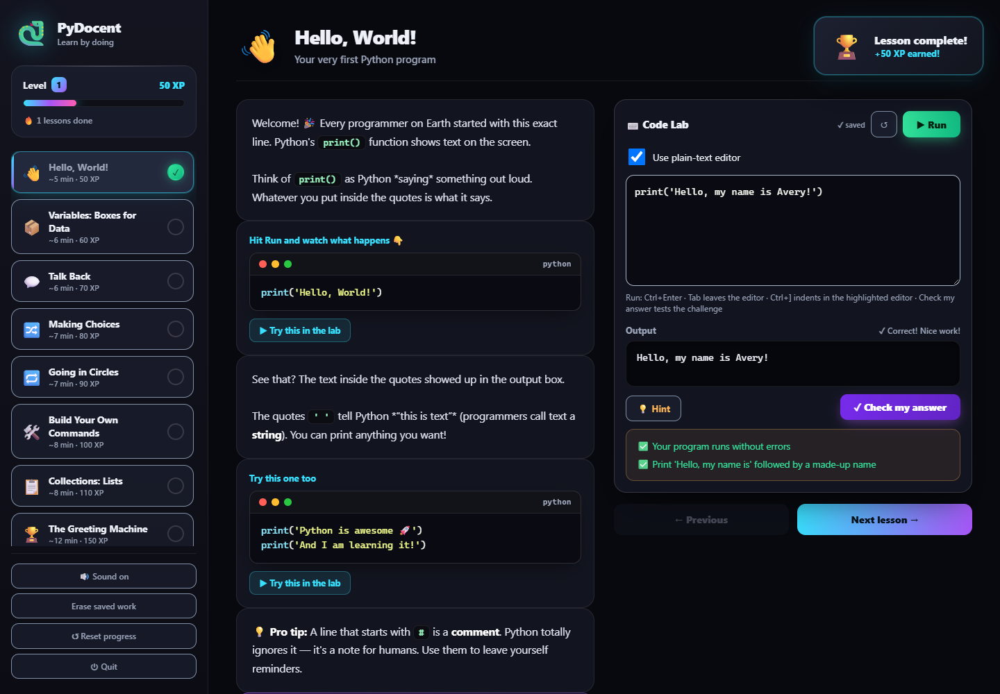

# PyDocent

**Your guide to learning Python**

PyDocent is a free, open-source project for beginners. Its eight short lessons go from writing a first greeting to building a small program with input, lists, loops, and functions. Every lesson includes examples to try, hints, and a challenge.

**Status: work in progress.** This preview runs locally from source. After setup, lessons work offline in Chrome or Edge.



## Try it locally

Download or clone the source and open a terminal in the PyDocent folder. With Python 3.14 installed, run these commands on Windows:

```powershell
py -3.14 -m venv .venv
.venv\Scripts\python.exe -m pip install -r requirements.txt
.venv\Scripts\python.exe fetch_runtime.py
.venv\Scripts\python.exe app.py
```

The setup downloads the Python dependencies and a verified browser runtime. When the app opens, choose **Start learning** or pick any lesson. If your browser does not open automatically, visit http://127.0.0.1:5001/. Click **Quit** when you are done.

On macOS or Linux, use `python3` to create the environment and `.venv/bin/python` for the subsequent commands. This preview was tested on Windows.

## What to expect

- Run real Python and get feedback on each lesson challenge.
- Use the highlighted editor or switch to a plain-text editor.
- Use imaginary names and ages in examples. Code, sample input and XP are saved in `progress.json` in this folder.
- Use **Erase saved work** to clear that copy. If you made backups, manage those separately.

PyDocent runs learner code in a disposable browser worker. See the [local execution and reporting policy](SECURITY.md) and [accessibility notes](ACCESSIBILITY.md).

For ordinary bugs, open an issue with the lesson, browser, and steps to reproduce. Use fictional data in examples and screenshots. Original code and lessons use the [MIT License](LICENSE). The editor and downloaded runtime have separate [third-party terms](THIRD_PARTY_NOTICES.md).
